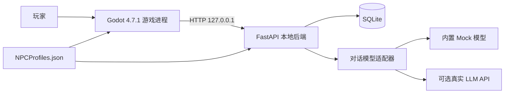
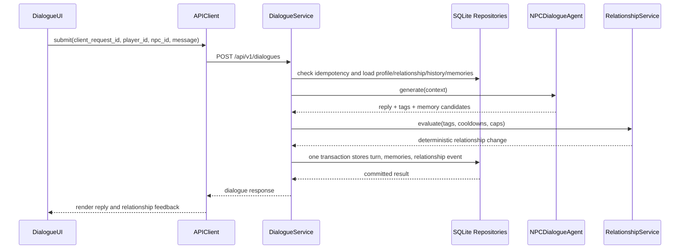
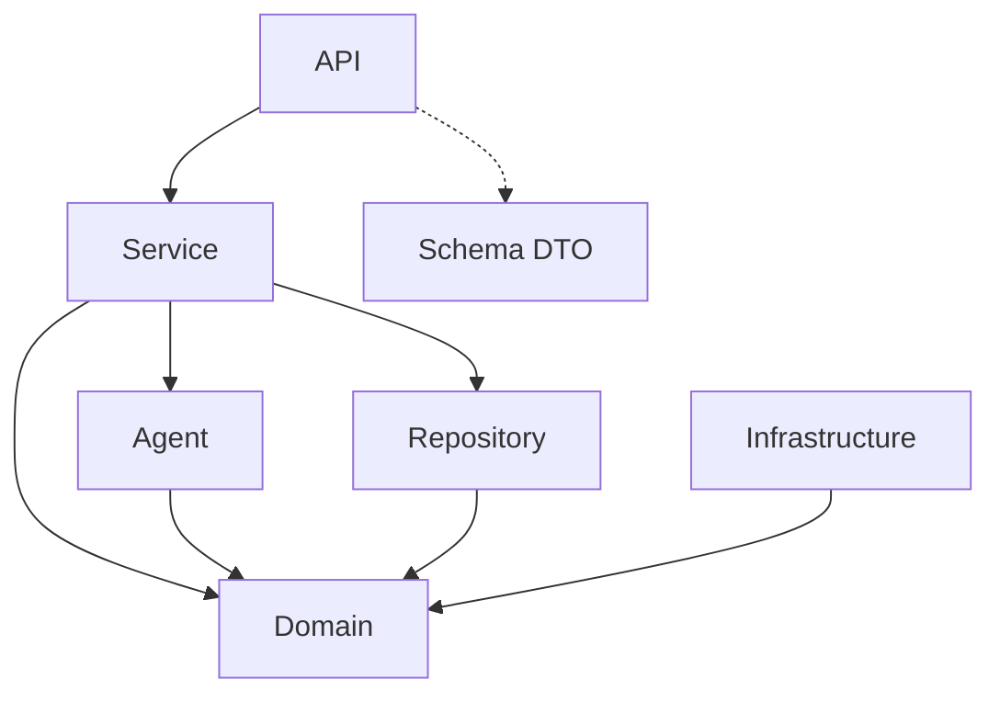

# 系统架构设计

状态：Approved v1.0，已于 2026-08-02 确认

## 1. 架构目标

系统需要同时满足四个约束：游戏主循环不被 AI 阻塞、角色数据可编辑、关系和记忆可测试持久化、发布包无需用户安装开发环境。

为此，首版采用三个运行边界：



- Godot 是游戏表现和本地交互权威。
- FastAPI 是对话、关系、记忆和持久化权威。
- 模型适配器只返回表达结果、受限互动标签和记忆候选，不直接修改状态。

## 2. 核心边界

### 2.1 Godot 边界

Godot 负责输入、移动、碰撞、摄像机、NPC 巡逻、交互目标选择、对话界面、等待和错误表现。所有 HTTP 调用异步完成。

Godot 不负责关系计分、长期记忆、提示词拼装和模型调用。它只展示后端返回的权威结果。

### 2.2 后端边界

API 层只验证请求并调用服务。服务层编排对话流程。领域对象表达稳定规则。Repository 是唯一访问 SQLite 的层。Agent 层负责上下文和模型适配，但不能直接写数据库。

### 2.3 模型边界

模型输入仅包含当前 NPC 配置、关系阶段、有限近期对话、最多三条相关记忆和当前玩家消息。

模型输出经过结构校验后形成：

- `reply`：给玩家的文本。
- `interaction_tags`：白名单标签，例如 `respectful`、`helpful`、`rude`。
- `memory_candidates`：建议保存的结构化事实，最终仍由服务校验。

模型没有终端、文件系统、数据库写入、任意网络或游戏状态修改工具。

## 3. 对话处理时序



模型调用发生在数据库事务之外，避免长事务。每个 `player_id + npc_id` 使用进程内异步锁串行化提交；`client_request_id` 有唯一约束，重复请求返回首次结果而不重复计分。

## 4. 失败路径

| 故障 | 后端行为 | Godot 行为 |
| --- | --- | --- |
| 未配置模型 | 使用 `MockDialogueModelClient` | 正常体验，显示“本地模式”状态 |
| 模型超时或无效输出 | 使用角色化降级回复，不改变关系 | 显示回复和轻量降级标记，可继续输入 |
| SQLite 写入失败 | 返回可识别错误，不伪造成功 | 保留玩家输入，显示重试按钮 |
| 后端不可达 | 无状态变化 | 对话面板显示离线，仍可关闭和移动 |
| NPC 配置无效 | 后端拒绝启动并列出字段错误 | 启动画面显示配置错误，不进入半可用状态 |
| 重复提交 | 返回原请求结果 | 不重复显示或重复计分 |

## 5. NPC 内容流

`Content/NPCProfiles.json` 是唯一人工编辑源：

1. 开发模式下，Godot 与后端都读取仓库根目录下的同一文件。
2. 发布构建时，该文件原样复制到发布目录的 `Content/`。
3. Godot 做最小展示字段校验，后端做完整 Schema 校验。
4. 配置修改需要重启；`npc_id` 不变时，历史关系和记忆继续关联。
5. 配置版本随 API 返回，便于诊断前后端是否读取同一内容。

## 6. 目标目录与文件职责

不为 Python namespace package 新增 `__init__.py`。

```text
Chapter15/
|-- .gitignore
|-- README.md
|-- REQUIRE.md
|-- BRIEF.md
|-- PLAN.md                         # 设计确认后创建
|-- Content/
|   `-- NPCProfiles.json            # 唯一 NPC 内容源
|-- Design/
|   |-- Architecture.md
|   |-- InteractionDesign.md
|   |-- APIContract.md
|   |-- DataModel.md
|   |-- NPCConfiguration.md
|   `-- ReleaseDesign.md
|-- Godot/
|   |-- project.godot
|   |-- export_presets.cfg
|   |-- Autoload/
|   |   |-- GameSession.gd          # 玩家身份、后端模式和启动状态
|   |   |-- APIClient.gd            # 异步 HTTP、超时、信号和请求映射
|   |   `-- ContentLoader.gd        # 定位并读取统一 NPC 配置
|   |-- Scenes/
|   |   |-- Main.tscn               # 办公室、碰撞、角色实例和 UI 组合
|   |   |-- Player.tscn             # 玩家移动与碰撞主体
|   |   |-- NPC.tscn                # 数据驱动 NPC 通用场景
|   |   |-- DialogueUI.tscn         # 底部对话面板
|   |   |-- InteractionPrompt.tscn  # 当前目标的交互提示
|   |   `-- StartupOverlay.tscn     # 后端启动、离线和配置错误状态
|   |-- Scripts/
|   |   |-- Main.gd                 # 加载角色、协调场景级事件
|   |   |-- Player.gd               # 输入、移动、目标选择和交互触发
|   |   |-- NPC.gd                  # 巡逻、停留、气泡和交互范围
|   |   |-- DialogueUI.gd           # 对话状态机、输入与渲染
|   |   |-- InteractionPrompt.gd    # 提示位置和目标切换
|   |   `-- StartupOverlay.gd       # 启动状态展示与重试
|   |-- Assets/
|   |   |-- Characters/             # 原创角色 PNG/SpriteFrames
|   |   |-- Interior/               # 原创地板、墙体和家具 PNG
|   |   |-- UI/                     # 图标、九宫格面板和光标
|   |   |-- Fonts/                  # 随包分发的中文字体及许可证
|   |   `-- Audio/                  # 后续可替换的环境与交互音效
|   `-- Tests/
|       |-- TestRunner.gd           # 无外部插件的 headless 测试入口
|       `-- InteractionTests.gd     # 目标选择和 UI 状态测试
|-- backend/
|   |-- pyproject.toml
|   |-- .env.example
|   |-- CyberTown/
|   |   |-- main.py                 # FastAPI 应用工厂和命令行入口
|   |   |-- Config.py               # 环境配置和路径解析
|   |   |-- API/
|   |   |   |-- HealthRouter.py     # 健康和运行模式
|   |   |   |-- NPCRouter.py        # NPC 列表与状态读取
|   |   |   |-- DialogueRouter.py   # 会话读取和对话提交
|   |   |   `-- ErrorHandler.py     # 统一公共错误结构
|   |   |-- Schema/
|   |   |   |-- HealthSchema.py     # 健康响应 DTO
|   |   |   |-- NPCSchema.py        # NPC API DTO
|   |   |   `-- DialogueSchema.py   # 对话请求/响应 DTO
|   |   |-- Domain/
|   |   |   |-- NPCProfile.py       # 配置领域对象和约束
|   |   |   |-- Dialogue.py         # 消息、回复和处理结果
|   |   |   |-- Relationship.py     # 等级、规则和变化事件
|   |   |   `-- MemoryEvent.py      # 结构化长期记忆
|   |   |-- Agent/
|   |   |   |-- BaseDialogueModelClient.py
|   |   |   |-- MockDialogueModelClient.py
|   |   |   |-- OpenAICompatibleDialogueModelClient.py
|   |   |   |-- NPCContextBuilder.py
|   |   |   `-- NPCDialogueAgent.py
|   |   |-- Service/
|   |   |   |-- NPCService.py       # 配置读取和可展示状态
|   |   |   |-- DialogueService.py  # 对话用例总编排和幂等
|   |   |   |-- RelationshipService.py
|   |   |   `-- MemoryService.py
|   |   |-- Repository/
|   |   |   |-- Database.py         # 连接、迁移和事务
|   |   |   |-- DialogueRepository.py
|   |   |   |-- RelationshipRepository.py
|   |   |   `-- MemoryRepository.py
|   |   |-- Infrastructure/
|   |   |   `-- NPCConfigLoader.py  # JSON 读取和完整校验
|   |   `-- Observability/
|   |       |-- Logging.py          # JSON 日志和脱敏
|   |       `-- RequestContext.py   # request_id 上下文
|   `-- tests/
|       |-- test_api.py
|       |-- test_dialogue_service.py
|       |-- test_relationship_service.py
|       |-- test_memory_service.py
|       `-- test_npc_config.py
|-- Scripts/
|   |-- BuildRelease.ps1            # 后端冻结、Godot 导出和组装
|   `-- SmokeTest.ps1               # 发布包健康与启动冒烟
`-- Release/                        # 生成物，Git 忽略
```

## 7. 依赖方向



禁止反向依赖：Domain 不导入 FastAPI、SQLite、HTTP 客户端或 Godot 概念；Agent 不直接访问 Repository；Router 不直接执行 SQL。

## 8. 并发与状态

- 首版单玩家，但所有数据库键包含 `player_id`。
- 每个 `player_id + npc_id` 同时只处理一个对话提交。
- NPC 是否正在与本地玩家交互由 Godot 管理，不写入全局数据库忙碌状态。
- 关系和记忆是后端权威状态；位置和巡逻是 Godot 当前会话状态。
- 后端重启不需要恢复 NPC 坐标，只需恢复关系、消息和长期记忆。

## 9. 后续替换点

Qdrant、Neo4j 和非 OpenAI 兼容模型只能通过现有边界新增实现，不能改变 DialogueService、API 契约或 Godot 调用方式。首版不创建空实现，也不安装相关依赖。
