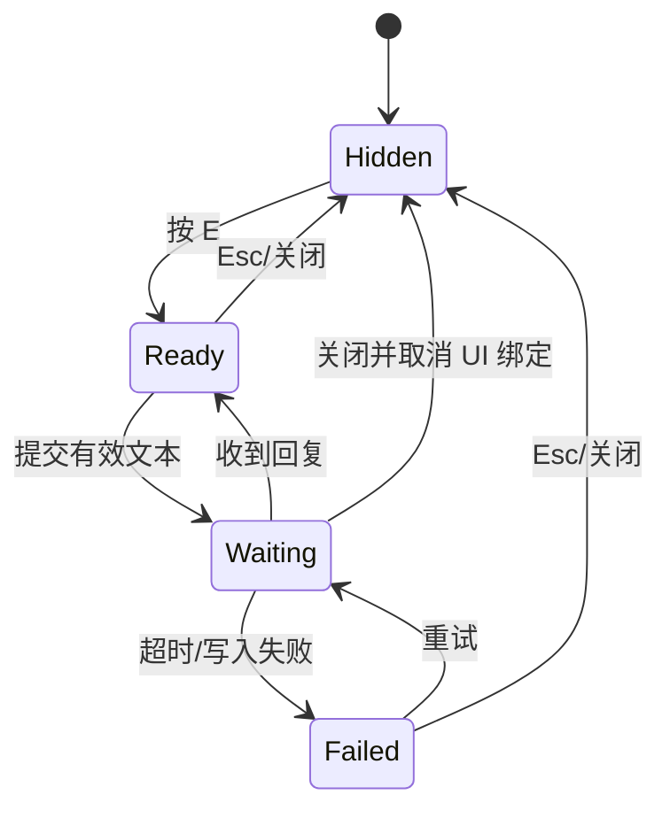

# 交互与视觉设计

状态：Approved v1.0，已于 2026-08-02 确认

## 1. 画面结构

基准视口为 1280 x 720。游戏直接进入主场景，办公室占满画面，不使用外层装饰卡片。

```text
+--------------------------------------------------------------------------+
| [赛博小镇] [本地模式/在线]                                             |
|                                                                          |
|  工程区                 公共讨论区                   设计区              |
|  张旭                   长桌/白板                    胡佳烙              |
|                                                                          |
|                玩家                         产品区                       |
|                                             樊玥燚                       |
|                                                                          |
|                         [ E  与樊玥燚交谈 ]                               |
+--------------------------------------------------------------------------+
```

场景要保持清晰的环形行走路线，主要家具与墙体形成自然边界，三名 NPC 的初始位置均能在十秒内到达。

## 2. 原创场景方向

主题为“夜间仍在运转的近未来创意工作室”，不复刻参考图的日式榻榻米布局。

- 工程区：青绿色终端屏幕、线缆槽、双显示器和工具架。
- 产品区：琥珀色便签墙、路线图、会议屏和计时器。
- 设计区：珊瑚色色板、样张台、灯箱和材料架。
- 公共区：低矮会议桌、饮水台、植物和共享白板。
- 场景边缘使用冷灰墙体，中央保持更明亮的行走区。

主色不是单一蓝紫：

| 用途 | 颜色 |
| --- | --- |
| 地面/主背景 | `#D9DDD7`, `#B7C0B7` |
| 墙体/深结构 | `#273238`, `#3E4A4D` |
| 工程强调 | `#29A7A0` |
| 产品强调 | `#E0A33A` |
| 设计强调 | `#D86B63` |
| 交互焦点 | `#F2D35C` |
| 正向关系 | `#57A773` |
| 错误/下降 | `#C94B55` |

## 3. 角色识别

- 玩家：中性深色服装配亮黄色胸牌，在任何地面上都清晰。
- 张旭：青绿外套和深色耳机，活动于工程区。
- 樊玥燚：琥珀外套和便签夹板，活动于产品区。
- 胡佳烙：珊瑚外套和色卡配件，活动于设计区。

角色使用相同像素尺度和碰撞脚底。姓名标签只在交互距离内或当前目标上显示，避免场景长期充满文字。

三名 NPC 均采用原创虚构外观，不使用真人照片、肖像特征或对现实人物的外貌还原。

## 4. 输入映射

| 操作 | 键鼠 |
| --- | --- |
| 移动 | WASD / 方向键 |
| 交互 | E |
| 提交对话 | Enter |
| 输入换行 | Shift + Enter，不在首版支持多行时禁用 |
| 关闭对话 | Esc 或关闭图标按钮 |
| 重试失败请求 | 对话面板中的刷新图标按钮 |

同一时刻只能有一个交互目标。候选目标按距离选取；距离相同时优先选择玩家朝向前方的 NPC。目标切换不得造成提示尺寸变化或跳动。

## 5. 对话面板

对话面板贴底展开，高度约 292 px，背景为高不透明度石墨灰。它不遮住 NPC 所在的上半场景。

```text
+--------------------------------------------------------------------------+
| 胡佳烙  视觉与交互设计师        [友好]                         [关闭] |
|--------------------------------------------------------------------------|
| 胡佳烙  上次你提到喜欢克制的界面，我记得。                             |
| 玩家    那这次应该怎么处理状态提示？                                   |
| 胡佳烙  [生成中 ···]                                                     |
|--------------------------------------------------------------------------|
| 输入消息...                                         [重试] [发送图标]  |
+--------------------------------------------------------------------------+
```

- 标题区显示姓名、职业和关系等级，不显示内部 ID。
- 主界面不显示精确关系分数，只显示等级与本回合变化；精确分数保留在后端和诊断信息中。
- 历史区按角色区分颜色，不使用彩色聊天气泡堆叠卡片。
- 输入区高度固定，最长 300 个字符；显示剩余字数只在接近上限时出现。
- 发送使用熟悉的箭头/发送图标并提供工具提示；关闭使用 X 图标。
- 等待时输入框禁用，发送图标变为固定尺寸的进度符号，布局不位移。
- 关系变化使用一行短反馈，例如“关系 +2 · 认真回应”，两秒后淡出。
- 后端降级回复显示细小“本地回应”标记，不把技术错误写进对话正文。

## 6. 状态机



关闭等待中的面板不取消后端请求，但响应到达后不得重新弹开面板。结果仍可持久化，下次打开时从历史接口显示。

## 7. 交互提示

提示固定为紧凑的图标加命令：键帽 `E`、交谈图标、NPC 姓名。它位于玩家与目标 NPC 的屏幕中点上方，并经过边缘约束，不得超出视口。

没有目标时不显示操作教学文字。第一次进入场景可短暂显示 WASD 键位图标，玩家移动后自动消失且不再出现。

## 8. 启动和离线状态

- 启动时直接显示场景，中央仅出现小型“正在启动本地服务”状态，不使用启动营销页。
- 五秒内后端就绪则状态自然消失。
- 启动失败时显示“本地服务未启动”，提供重试和退出两个命令；场景保持可见。
- 后端运行但真实模型未配置时，顶栏显示“本地模式”，不视为错误。
- 模型暂时失败时自动降级，顶栏状态不弹窗打断玩家。

## 9. 动效与声音

- 玩家和 NPC 至少有四方向静止/行走反馈；若首批资源帧数有限，可用两帧步行动画。
- 当前交互目标使用一圈 1 px 琥珀描边脉冲，周期 1.2 秒，不改变角色尺寸。
- 对话面板在 140 ms 内自底部进入；尊重固定布局，不用弹性缩放。
- 首版音频若缺少合适原创资源，可静音交付；不得用来源不明的素材填充。

## 10. 可用性检查

- 中文正文基准字号 18 px，姓名 22 px，紧凑状态 14 px。
- 字体随包分发，必须包含使用许可证。
- 所有文本在 1280 x 720 下不重叠；长 NPC 名称允许一行省略并在详情中完整显示。
- 重要状态不能只靠颜色表达，同时使用图标或文字。
- UI 焦点顺序为输入框、重试、发送、关闭；键盘可完成全部对话操作。
