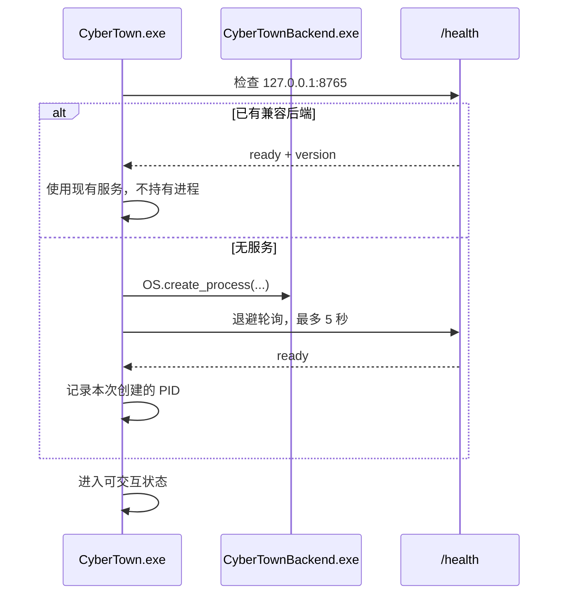

# Windows 发布设计

状态：Approved v1.0，已于 2026-08-02 确认

## 1. 发布目标

测试者解压后双击 `CyberTown.exe` 即可进入游戏，不需要安装 Godot、Python、Qdrant 或 Neo4j。默认 mock 模式无需 API 密钥。

## 2. 发布目录

```text
CyberTown-v0.1.0-windows-x86_64/
|-- CyberTown.exe
|-- CyberTown.pck
|-- Backend/
|   |-- CyberTownBackend.exe
|   `-- _internal/...
|-- Content/
|   `-- NPCProfiles.json
|-- README.txt
`-- LICENSES/
    |-- Godot.txt
    |-- Font.txt
    `-- ThirdParty.txt
```

后端首版使用 PyInstaller one-folder 模式，便于诊断缺失依赖，并避免 one-file 每次启动解压造成的额外延迟。游戏 PCK 与可执行文件分离，方便检查发布内容。

## 3. 一键启动流程



Godot 只在退出时终止自己创建且仍存活的后端 PID。若检测到兼容的既有服务，不负责终止它。

## 4. 运行路径

- 配置：发布目录 `Content/NPCProfiles.json`，用户可编辑。
- SQLite：`%APPDATA%/CyberTown/Data/CyberTown.db`。
- 日志：`%APPDATA%/CyberTown/Logs/`。
- 用户设置：Godot `user://Settings.cfg`。
- 密钥：不写进发布目录；真实模型由用户自行创建本地 `.env` 或系统环境变量。

安装目录视为只读，所有运行时写入进入用户数据目录。

## 5. 端口与进程

- 后端只绑定 `127.0.0.1:8765`。
- 若端口已被非兼容服务占用，启动界面报告端口冲突，不随机换端口造成客户端失配。
- 后端支持 `--port`、`--data-dir`、`--content-path` 和 `--dialogue-mode` 参数，开发模式可覆盖。
- Godot 启动后端时不打开控制台窗口；日志写入用户日志目录。

## 6. 构建流程

`Build/BuildRelease.ps1` 执行以下步骤并在任一步失败时停止：

1. 检查 Git 工作区和版本号输入。
2. 创建独立构建临时目录。
3. 在受控 Python 环境运行后端测试。
4. 使用 PyInstaller one-folder 构建 `CyberTownBackend.exe`。
5. 对冻结后端运行健康检查冒烟测试。
6. 使用已提交的 `export_presets.cfg` 导出 Godot Windows Release。
7. 复制内容配置、README 和许可证。
8. 扫描发布目录，拒绝 `.env`、数据库、日志、缓存和测试文件。
9. 启动完整发布包并执行截图与交互冒烟。
10. 生成 ZIP 和 SHA-256 校验文件。

Godot 导出需要 4.7.1 对应的 Windows export template。开发前置检查会验证模板是否已安装；缺失时停止并报告，不假装完成发布验收。

## 7. 开发运行

开发者可以分别运行：

```powershell
python -m src.main --dialogue-mode mock
D:\Godot\Godot_v4.7.1-stable_win64.exe --path E:\HelloAgents\CyberTown\Game
```

具体虚拟环境命令和 Python 支持版本在开发计划中锁定，并以实际依赖测试为准。

## 8. 发布验收

- 在不依赖系统 Python 的环境启动冻结后端。
- 在未配置模型密钥时自动进入 mock 模式。
- 游戏启动、退出和再次启动不会遗留占用端口的子进程。
- 修改 `Content/NPCProfiles.json` 后重启，角色更新生效。
- 发布目录不包含 `.git`、`.env`、数据库、日志或个人数据。
- 1280 x 720 截图中场景非空、角色可见、文本不重叠、对话面板不遮挡关键交互对象。

## 9. 设计依据

- [Godot 官方导出文档](https://docs.godotengine.org/en/stable/tutorials/export/exporting_projects.html)说明 `export_presets.cfg` 可提交到版本控制，并支持命令行 Windows release 导出。
- [Godot OS API](https://docs.godotengine.org/en/stable/classes/class_os.html)中的 `OS.create_process()` 返回可监控和终止的 PID，适合由游戏启动独立后端。
- [PyInstaller 官方运行模式说明](https://pyinstaller.org/en/stable/operating-mode.html)建议先验证 one-folder 构建，再考虑 one-file；首版保持 one-folder 以降低发布诊断风险。
